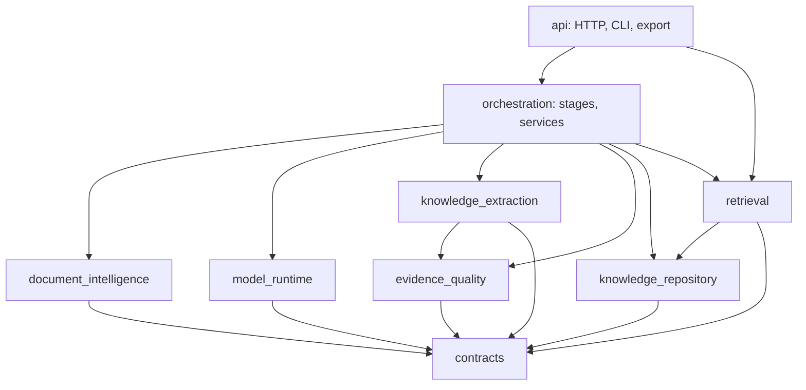

# Architecture

This document describes how Knowledge Map is organised after the architecture alignment of
November 2026: the assessment that started it, the module structure, how data flows through the
interfaces, what was kept, changed, merged or retired, the tests, and the gaps that remain.

The target blueprint ("KnowPal Complete Implementation Pipeline & Technology Stack") was not
available as a file in the repository. The work follows the requirements written in the request
and the concept note `Knowledge_Map_1pager.docx`.

## 0. Finalisation (November 2026)

The finalisation completed the platform on this architecture; `docs/IMPLEMENTATION_STATUS.md`
is the living checklist with measured results. Additions by component:

| Component | Added |
|---|---|
| contracts | `ontology.py` (core types plus project extensions); `HistoryEntry`, `Proposal`; `uncertainty` on every item; claim `kind` and `modality` |
| document_intelligence | `text_formats.py` (DOCX, HTML, Markdown through the page sidecar), `quality.py` (digital, scanned, mixed) |
| knowledge_extraction | `resolution.py` (model-judged canonical resolution, reviewer overrides), `contributions.py` (agent and human proposals as Pass 1 candidates) |
| evidence_quality | `injection.py` (untrusted document text), `uncertainty.py` (modality and uncertainty from wording), `units.convert` |
| knowledge_repository | history, ontology, proposals, agent activity in `repository.py`; `locks.py` (one writer per project); `backup.py` |
| retrieval | `knowledge_graph.py` (governed graph: exploration, paths, claims, conflicts, map payload), `semantic.py` (passage index), `hybrid.py` (fusion, research answers) |
| orchestration | services for all of the above; `agents.py` (grants, audit), `evaluation.py`, `benchmark.py` |
| api | `mcp_server.py` (MCP over stdio), new REST endpoints and CLI commands |
| web | `sphere.js` (overview, review, research, governed concept panel) |

One dependency rule changed: `retrieval` may import `evidence_quality` (contradiction detection and
unit conversion inside answers); both depend only on `contracts`.

## 1. Assessment of the previous architecture

Findings from reading every module before any change:

| Area | Finding |
|---|---|
| Duplicated responsibilities | Two independent graph pipelines (GLiNER in `src/knowledge`, concept-first in `src/kg`) each with their own merging, validation and storage. Two `Embedder` protocols. The "upsert and delete stale records" helper lived in `knowledge/merging.py` but was used by storage. Settings were split between `src/config.py` and `src/kg/config.py`. |
| Inconsistent schemas | Knowledge records were untyped dicts with different evidence shapes: GLiNER quotes as `{quote, start, end}` on a page, concept-first evidence as `{page_start, page_end, chunk_start, chunk_end}`, relationship evidence with `kind`. Only concept-first items had a status (`supported`, `needs_review`, `rejected`); GLiNER items had none. No claims, no document versions. |
| Direct dependencies | The API queried MongoDB directly for documents, pages and images and contained the document-listing rules. The CLI repeated project and document logic. The LLM client was created inside the orchestrator (`create_client`) with a hard-coded provider list; GLiNER and fastembed classes were defined inside extraction modules; the image captioner inside image extraction. |
| Missing interfaces | No parser interface (PyMuPDF was called directly), no model router (no local model support at all, although Qwen had been evaluated in `reports/qwen25vl_evaluation.md`), no repository interface, no retrieval interface, no vision model interface. |
| Acceptance | Local validation existed for concept-first items, but nothing separated "proposed" from "accepted" knowledge for the whole graph, nothing checked numbers or contradictions, and no reviewer decision could be stored. |
| Recovery | Stages were already idempotent at good granularity (GLiNER per page, Pass 1 per chunk, images per document), but nothing recorded which stage failed. |

## 2. Module structure

One folder per component. Each folder's `__init__.py` states its boundary.

```
src/contracts/              shared contracts, no dependency on any other component
    schemas.py              canonical Pydantic models, version knowpal-1
    interfaces.py           protocols: TextModel, VisionModel, SpanModel, Embedder, Captioner,
                            DocumentParser, KnowledgeRepository, Retriever; LLM response and errors
    ids.py                  stable_id and project-scoped IDs
    vocabulary.py           concept and relation types, local candidate shapes, chunk-to-page mapping
src/document_intelligence/  pdf_extraction.py (PyMuPDF + Tesseract, unchanged), images.py, segmentation.py,
                            parsers.py (Docling and PyMuPDF structure adapters)
src/model_runtime/          router.py (capabilities, memory budget, sequential gate), ollama.py (Qwen,
                            Qwen2.5-VL), llm.py (Claude), gliner.py, embeddings.py, vision.py (ViT captioner)
src/knowledge_extraction/   candidates only: gliner_concepts.py, merging.py, relationships.py, image_links.py,
                            llm_extraction.py, prompts.py, llm_schema.py, recovery.py, claims.py, visual.py,
                            enrichment.py
src/evidence_quality/       validation.py (local rules), governance.py (checks, status rule), units.py,
                            service.py (validate one project through the repository interface)
src/knowledge_repository/   mongodb_store.py, repository.py (KnowledgeRepository), canonical.py (stored record
                            <-> canonical model), kg_store.py, projects.py, metadata.py
src/retrieval/              lexical_index.py (BM25 index), engine.py (search, ask, concept detail, graph payload),
                            graph.py (NetworkX)
src/orchestration/          pipeline.py (stages), kg_pipeline.py (concept-first stages), documents.py (document
                            lifecycle), watcher.py, stages.py (stage tracking), services.py (application services)
src/api/                    interfaces: app.py (HTTP), cli.py and kg_cli.py (command line), obsidian_exporter.py
```

## 3. Dependencies and data flow

The allowed directions below are enforced by `tests/test_architecture.py` on the real import graph.



Remaining exceptions, listed file by file in the test so the list can only shrink: `images.py`,
`gliner_concepts.py`, `merging.py`, `relationships.py` and `image_links.py` still read and write
MongoDB themselves (they are the older GLiNER-side stages); `gliner_concepts.py` builds the GLiNER
model in its own command line entry point; `api/cli.py` calls single stages for operator commands.

Data flow of one project (no record ever crosses projects):

```
PDF -> pdf_extraction (PyMuPDF / Tesseract) -> pages, images, metadata, document_versions   [no model]
    -> parsers (Docling | PyMuPDF) -> section / table / figure / equation units               [no model]
    -> segmentation -> chunks
    -> router.text_model()   -> llm_extraction (concepts, relationships), claims             candidates
    -> router.vision_model() -> visual (figures, grounded on caption + context + OCR)        candidates
    -> router.span_model()   -> gliner_concepts -> merging -> relationships                  candidates
    -> validation (quotes located in the unit text, vocabulary, endpoints)
    -> enrichment (Pass 2 across documents: text chunks and figures alike)
    -> repository.knowledge() -> canonical Concept / Relationship / Claim
    -> governance checks -> KnowledgeStatus -> repository.save_validation()
    -> retrieval (rejected items hidden), services -> API, CLI
```

Verified flows (each one is exercised by a test, not only present in code):

- Text, claim and figure candidates from fake models reach `kg_concepts` and `kg_claims` through
  the router protocols, are merged into one concept across text and figure, are governed, and are
  served with their status (`test_knowledge_lifecycle.py::test_text_claims_and_figures_flow_into_one_governed_graph`).
- The GLiNER graph is read through the repository as canonical models, governed, and a concept
  whose evidence no longer matches its page is rejected and disappears from retrieval
  (`test_governance_runs_on_the_gliner_graph_and_retrieval_hides_rejected`).
- The API, the CLI and future interfaces call `KnowledgeApplication`; the API tests run every new
  endpoint through it (`test_api_exposes_governance_through_the_same_services`).
- On the real database, read-only: all 545 GLiNER concepts and 813 relationships load as canonical
  models with 0 schema errors, and governance in memory gives 497 verified and 48 corroborated
  concepts, 811 verified and 2 corroborated relationships, in 0.4 s. Nothing was written.

## 4. Canonical knowledge model

`src/contracts/schemas.py`, `SCHEMA_VERSION = "knowpal-1"`. Every model rejects unknown fields and
states its schema version.

| Model | Purpose |
|---|---|
| `Document`, `DocumentVersion` | A document and each file version in its lineage (`lineage_id`, `version`, `superseded_by`). |
| `ContentUnit` | Page, chunk, section, table, figure, image or equation, with page, section path, bounding box, provenance. |
| `Concept` | Concept or entity (`kind`), with aliases and description. |
| `Claim`, `Quantity` | Subject, predicate, object, statement, polarity, quantities read from the quote. |
| `Relationship` | Two different endpoints and a relation type. |
| `SourceRef`, `Evidence`, `Provenance` | Exact source location (project, document, version, unit, page, offsets, box), the quote, and who produced it (component, method, model, prompt version). |
| `ExtractionResult`, `CheckResult`, `ValidationRecord`, `Adjudication` | What an extractor proposed, each check's outcome, the status it led to, a reviewer's decision. |
| `ParsedDocument` | Parser output. |

Project isolation is part of the model: a knowledge item's evidence must come from its own project
(validation error otherwise), every repository call takes a `project_id`, and governance refuses an
item from another project.

## 5. Evidence governance

Extraction proposes; `evidence_quality/governance.py` decides. Checks are independent functions:

| Check | Blocking | Rule |
|---|---|---|
| `schema` | yes | the stored record is a valid canonical model |
| `evidence_trace` | yes | at least one quote is found in the stored text of the unit it cites (at its offsets, or anywhere in the unit) |
| `source_validity` | yes | the document belongs to the project, the unit belongs to the document, the page exists |
| `endpoint_validity` | yes for relationships | both endpoints are existing concepts of the same graph and project |
| `duplicate_alias` | no | no other concept claims the same name or alias |
| `numeric_consistency` | yes | numbers in a claim occur in its evidence with a compatible unit (`units.py` converts kg/g, kPa/psi, kg/day and so on) |
| `contradiction` | no | claims that negate each other or state different values; inverse `is_a` / `includes` / `prerequisite_for` / `example_of` edges |

Status rule (`governance-1`): a reviewer decision gives `adjudicated`; a failed blocking check
gives `rejected`; a failed non-blocking check gives `needs_review`; otherwise `corroborated` when
traced evidence comes from two or more documents, else `verified`. The `confidence` field is
informational and never read by the rule (tested: a confidence of 1.0 with an invented quote is
rejected). Adjudications live in their own collection and survive every rebuild.

Visual candidates are grounded: a vision model must quote the caption, the text around the figure
or the Tesseract OCR of the image. Its free description is kept apart as `interpretation`.

## 6. Model runtime

`ModelRouter` hands out a model per capability (`text`, `vision`, `spans`, `embed`); extraction code
receives protocol objects and never imports a provider.

- Default text model: `qwen2.5:7b` through Ollama; vision: `qwen2.5vl:3b`; optional Claude with
  `KM_LLM_PROVIDER=anthropic`; GLiNER optional with `KM_USE_GLINER=0`.
- 16 GB RAM laptop: all local calls pass one `ResourceGate`, so one model works at a time, and the
  previous Ollama model is unloaded (`keep_alive: 0`) before another one is used. A model whose
  estimated memory is above `KM_MODEL_RAM_GB` (default 10) is refused before loading. The memory
  figures in `router.py` are estimates for 4-bit quantized weights, not measurements.
- Ollama 0.40.13 is installed on the development machine but no model is pulled, so no local
  inference has run. All model behaviour is tested with fakes.

## 7. Document intelligence and Docling

Parsers implement `DocumentParser` and add structure units next to the existing page text, which
is never replaced or re-extracted. `select_parser("auto")` uses Docling when the package is
installed, else PyMuPDF.

Docling was evaluated as the primary structured parser but is **not installed**: it brings its own
layout and OCR models and their PyTorch and Transformers requirements, while this environment pins
`torch==2.14.1` and `transformers==5.16.1` for GLiNER, and the previous session spent effort removing
version conflicts. The adapter is ready and tested against a fake converter only. To evaluate it:
install it in a copy of the `.venv`, run `python -m src.api.cli structure --parser docling
--document <id>` on one document, and compare with the PyMuPDF numbers below.

PyMuPDF structure parser on the four stored documents (measured, read-only, nothing saved):

| Document | Pages | Units found | Seconds |
|---|---|---|---|
| eclss-technical-brief-ochmo.pdf | 24 | 118 sections, 5 tables | 10.8 |
| ICES-2023-74.pdf | 14 | 15 sections, 13 figure captions, 5 equations | 5.8 |
| BVAD_2.15.22-final.pdf | 235 | 469 sections, 190 tables, 89 figure captions, 20 equations | 169.1 |
| NASA-STD-3000B_VOL-2.pdf | 503 | none (scanned, no text layer) | 177.8 |

Most of the time is table detection. The scanned standard is the concrete case where Docling (with
its OCR layout model) would add value.

## 8. Persistence decision

MongoDB stays the canonical store. Inspection showed no requirement that it cannot meet today:

- Vectors: embeddings are used only to merge names (a few thousand short strings in memory); search
  is BM25. pgvector or Qdrant would be justified only when semantic passage search is added and the
  corpus no longer fits an in-memory index.
- Graph: the largest graph has 545 nodes and 813 edges and is analysed with NetworkX in memory.
  Neo4j would be justified by multi-hop queries over far larger graphs.
- Relational integrity: project isolation and IDs are enforced in code and tested.

Because all knowledge reads go through `KnowledgeRepository` and `canonical.py`, a later move can
be done safely: implement the protocol for the new store, copy data with the canonical models (they
validate every record on the way), run both stores side by side, compare `knowledge()` output per
project, then switch the composition root in `api/`.

## 9. Retain, refactor, merge, retire

| Module | Decision |
|---|---|
| `pdf_extraction.py`, `mongodb_store.py`, `segmentation.py`, `merging.py`, `relationships.py`, `lexical_index.py`, `engine.py`, `graph.py`, `watcher.py`, `documents.py`, `projects.py`, `metadata.py`, web frontend | Retained (moved into their component folder; behaviour unchanged except where stated). |
| `kg/llm.py` | Refactored into the Claude provider behind `TextModel`; response and error types moved to contracts. |
| `kg/recovery.py` | Refactored to accept any output schema (used by concepts, claims and figures). |
| `kg/orchestrator.py` | Refactored into `orchestration/kg_pipeline.py` (claims, figures, governance) and `api/kg_cli.py`. |
| `pipeline.py` | Split into `orchestration/pipeline.py` (stages, models from the router, stage tracking, governance) and `api/cli.py`. |
| `api/app.py` | Refactored to call `orchestration/services.py` only; business rules moved there. |
| `kg/config.py` | Merged into `src/config.py`. |
| `kg/schema.py` vocabulary, `stable_id`, project ID helpers, `upsert_all` | Merged into contracts (`vocabulary.py`, `ids.py`) and the repository. |
| GLiNER class, fastembed class, ViT captioner | Moved out of extraction modules into `model_runtime`. |
| `link_images_to_concepts` | Moved from image extraction to `knowledge_extraction/image_links.py`. |
| `src/kg`, `src/knowledge`, `src/ingest`, `src/search`, `src/graph`, `src/export`, `src/storage` | Retired (their modules moved; the folders no longer exist). |

## 10. Implementation by stage

1. **Audit**: section 1, done before any change.
2. **Schemas and interfaces**: `contracts/` (schemas, protocols, IDs, vocabulary).
3. **Shared contracts in existing modules**: files moved with `git mv` into component folders,
   imports rewritten, model classes moved to `model_runtime`, stored records mapped to canonical
   models in `knowledge_repository/canonical.py` (no data migration).
4. **Text and visual extraction unified**: figures produce the same candidate record as text
   chunks and enter the same Pass 2; claims added with their own prompt version, so stored concept
   extractions stay valid.
5. **Governance**: `evidence_quality/governance.py`, run at the end of every GLiNER rebuild and
   every concept-first graph build, and on demand (`validate`).
6. **Repository and retrieval**: `MongoKnowledgeRepository` implements the protocol (documents,
   versions, units, structure, knowledge, validation, adjudication); retrieval hides rejected items
   and shows statuses.
7. **Orchestration and interfaces**: `KnowledgeApplication` serves the API and the CLI; stage runs
   are recorded; new commands and endpoints: structure, validate, rebuild, status, resume,
   versions, models, knowledge summary, validation record, adjudication.

## 11. Tests

`python -m pytest`: 125 tests pass (99 existing, 26 new). The existing tests changed only where a
module moved (import paths) and in one fake pipeline signature earlier; no assertion was weakened.

| File | What it proves |
|---|---|
| `test_contracts_runtime.py` | contract validation and isolation; Ollama request format, stop reasons and errors through a fake transport; router routing, memory budget, sequential execution and unloading |
| `test_governance.py` | each check alone, the status rule, confidence ignored, adjudication, unit conversion |
| `test_parsers.py` | PyMuPDF sections with hierarchy, tables, captions, equations on a generated PDF; Docling adapter with a fake converter; parser selection; structure storage leaves pages and other projects untouched |
| `test_knowledge_lifecycle.py` | the end-to-end flows listed in section 3, version lineage on replace, stage failure and recovery, API endpoints |
| `test_architecture.py` | the import boundaries, the exception list, contracts free of model, parser and database packages, retired folders gone |

A mutation check removed the evidence-trace check from governance: 7 tests failed, so the tests
detect a missing acceptance rule.

## 12. Remaining gaps

- **No real model run**: Ollama has no model pulled and no Claude call was made, so extraction,
  claim and figure quality, speed and memory use are unmeasured. The memory estimates are not
  benchmarks.
- **Docling not installed**: its adapter is tested only with a fake; the PyMuPDF fallback finds
  nothing on the scanned NASA standard and its equation detection is a heuristic.
- **Older stages still persist directly**: GLiNER extraction, merging, relationships, image
  extraction and image linking read and write MongoDB themselves instead of returning candidates to
  orchestration (listed in `tests/test_architecture.py`).
- **Two graphs, one map**: the GLiNER and concept-first graphs are governed with the same rules but
  stored separately; the web map still shows only the GLiNER graph.
- **Retrieval reads collections directly**: it depends on the repository module, not yet on the
  `KnowledgeRepository` protocol; semantic (embedding) passage retrieval does not exist.
- **Segmentation ignores parsed structure**: chunks follow headings found by the chunker, not the
  parser's section hierarchy; tables and equations are not chunked separately.
- **Governance limits**: contradiction detection compares claims with the same normalized subject
  and predicate only; unit support is a fixed table; there is no review screen yet (adjudication is
  available through the API).
- **Migration on first start**: the next server or CLI start adds `project_id` where missing (as
  before); governance then adds `knowledge_status` and `governance` fields on the next rebuild or
  `validate`. Nothing is deleted.
