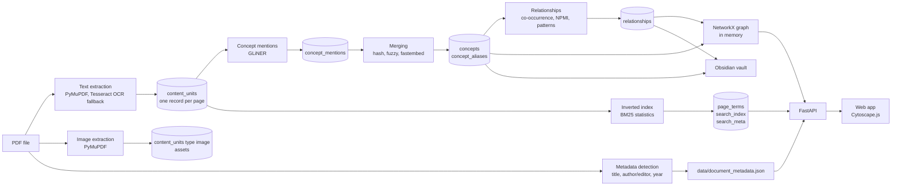
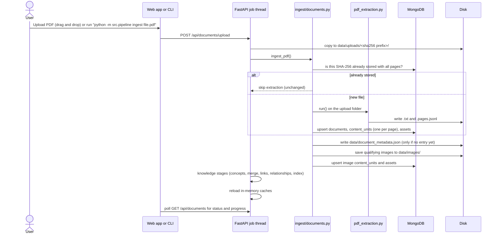
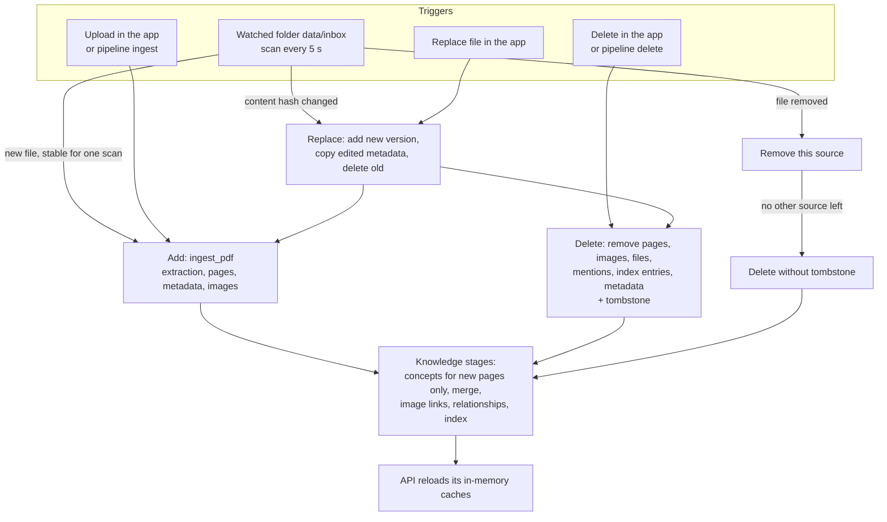
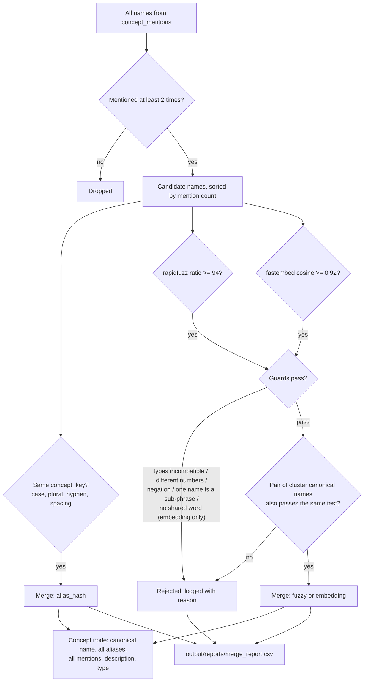
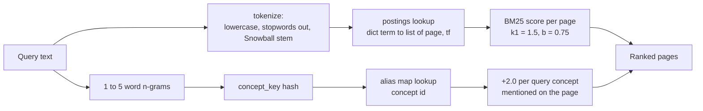
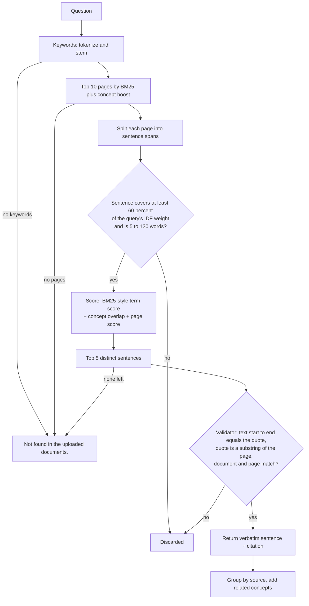
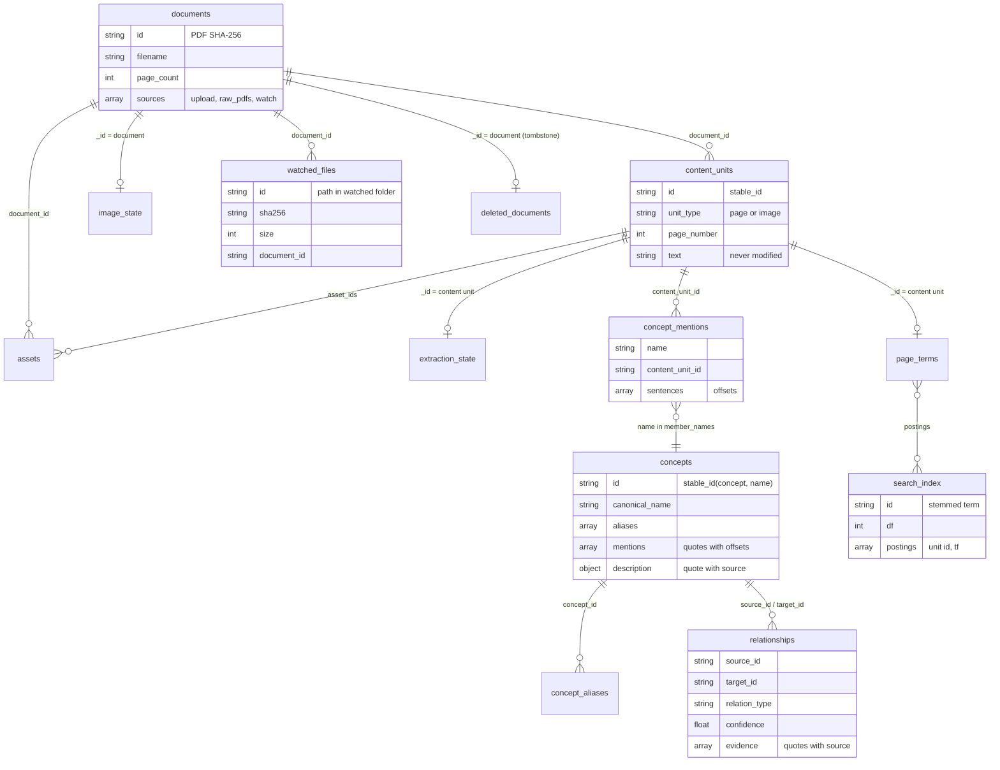

# Data flow: from PDF to cited answer

This document explains, step by step, how a PDF becomes a knowledge map and how a question gets an answer with citations. It only describes what is implemented in `src/`.

## 1. The big picture



MongoDB (database `knowledge_map`) is the source of truth. NetworkX only holds a copy of the graph in memory while the server runs. Files (PDFs, extracted images, the metadata JSON, the vault) stay on disk.

## 2. Components and what each one does

| Component | Job in this project | Where its output goes |
|---|---|---|
| PyMuPDF | Reads the text layer of each page, finds embedded images and their position, renders a page as an image for the viewer, reads PDF metadata. | `content_units`, `assets`, `data/images/` |
| Tesseract OCR | Used only for pages with little or no text layer but with raster content (scans). | `content_units.text` with `extraction_method: tesseract` |
| GLiNER (`urchade/gliner_medium-v2.1`) | A small BERT-family model that marks spans in text and gives each a label (for example "process", "method") and a score. Runs locally on CPU. It only points at text that exists on the page; it does not write text. | `concept_mentions` |
| fastembed (`BAAI/bge-small-en-v1.5`, ONNX) | Turns each concept name into a vector. Used only while merging concepts, never at query time. | used in memory during merging |
| rapidfuzz | Fast string similarity for catching spelling and OCR variants of the same name. | used in memory during merging |
| Snowball stemmer | Reduces words to a stem ("requirements" and "required" become "requir") for the keyword index. | `page_terms`, `search_index` |
| BM25 (own code) | Ranks pages for a keyword query. | in memory at query time |
| NetworkX | Holds the concept graph, computes degree, PageRank (importance) and Louvain communities (colors). | in memory |
| FastAPI + uvicorn | Serves the JSON API and the web page. | HTTP on port 8000 |
| Cytoscape.js | Draws the interactive graph in the browser. Stored in `src/web/vendor/`, so it works offline. | browser |

## 3. Ingestion and extraction



Details:

- **Document identity** is the SHA-256 of the PDF bytes. The same file uploaded twice is processed once.
- **Pages** are stored as `content_units` with `unit_type: "page"`. The page text is never changed after extraction. Quotes and citations always point back into this text.
- **Images**: an image is kept when it is at least 100 x 100 pixels, covers at least 1 percent of the page, and does not repeat on more than 3 pages (repeated images are logos or decorations). For each image we store page, bounding box, file path, a caption (the nearest text block that starts with "Figure", "Table" and similar, within 80 points), and the text within 150 points of the image (context). Images are separate `content_units` with `unit_type: "image"`.
- **Optional captioning** (`--caption-images`, off by default) runs a ViT-GPT2 model. Its output is stored as `model_caption`, marked with the model name, and is never used for answers or citations.
- **Metadata**: title, author/editor and year are taken only from text that is really there: PDF metadata fields (rejected when they look like junk such as "Intro" or a single user name), the largest text on page 1, "Edited by" / "Prepared by" lines, and copyright or date lines in the first 8 pages. Each value records where it was found. Anything not found is `null` and shows as "Unknown". The user can edit the file or use the form on the Documents screen; edited fields are never overwritten by detection.

### Changing and deleting documents, and the watched folder



- Every document lists its **sources**: `upload`, `raw_pdfs/<file>` or `watch:<path in the folder>`. Removing a file from the watched folder only removes that source. The document is deleted when no source is left.
- **Delete** removes the document's `content_units`, `assets`, `extraction_state`, `concept_mentions`, `page_terms` and `image_state` records, its folders under `data/uploads/` and `data/images/`, and its entry in `data/document_metadata.json`. Files in `data/raw_pdfs/` and in the watched folder are never deleted. Merging, relationships and the index are then rebuilt from what is left, so concepts and edges that only came from the deleted document disappear.
- A delete in the app writes a **tombstone** (`deleted_documents`) so that `pipeline run` and the watcher do not add the same file content back. An explicit upload of the same file removes the tombstone.
- **Replace** adds the new version first, copies the metadata fields the user edited, then deletes the old version.
- The **watcher** compares the folder with `watched_files` (path, size, modification time, SHA-256). A changed file is only read after its size and time stayed the same for one scan, so half-copied files are skipped. All changes found in one scan are processed as one job, followed by one run of the knowledge stages.

## 4. Concept extraction

1. Pages with `quality_status` of `no_text_detected` or `failed` are not read.
2. For every page, the SHA-256 of its text is compared with `extraction_state`. Unchanged pages are skipped, so a second run does no model work.
3. Table-of-contents pages (many lines ending in dot leaders and a page number) and near-empty pages (fewer than 15 real words) are skipped.
4. Dot leaders are replaced by spaces of the same length, so character offsets stay valid.
5. Pages are cut into 200-word chunks. Chunks from 24 pages at a time are sorted by length and sent to GLiNER in batches of 8.
6. Each span is cleaned and normalized (lowercase, leading "the/a/an" removed, last word made singular). Noise is dropped: a stoplist of generic words (for example "system", "documentation", "page", "figure"), fragments that start or end with a function word ("of the system"), names with mostly digits or symbols, very short or very long names.
7. One `concept_mentions` record is written per (name, page) with surface forms, label scores and the sentence spans (start and end offsets into the page text) where the name occurs. Results are saved after every page, so an interrupted run resumes where it stopped.

## 5. Concept merging: similar meaning becomes ONE node



- The canonical node is the member with the most mentions. Its ID is `stable_id("concept", normalized name)`, a SHA-256 hash, so it is the same on every run.
- "Compatible types" means: engineering concept, process and method may merge with each other; system component, document and organization only merge with their own type.
- Examples that are blocked on purpose: "design review" and "preliminary design review" (sub-phrase), "functional requirement" and "non-functional requirement" (negation), "phase 1 review" and "phase 2 review" (different numbers).
- The description of a node is a sentence copied from a page, preferring a definition-like sentence ("X is ...", "X refers to ..."). It keeps its document, page and offsets, so it can be cited and checked.
- `concept_aliases` maps the hash key of every alias to its concept, which gives O(1) lookups.

## 6. Relationships

- Two concepts **co-occur in a sentence** when they share a sentence span on the same page.
- A **page window** is a page plus the next page of the same document. Window counts are used for NPMI (normalized pointwise mutual information).
- An edge is kept when the pair shares at least 2 sentences, or 1 sentence with NPMI >= 0, or (no shared sentence) at least 3 windows with NPMI >= 0.35.
- **Type**: `related_to` by default. It is upgraded only when a pattern matches the words between the two names in an evidence sentence: `is_a` ("A is a type of B", "B, such as A"), `part_of` ("A is part of B", "B consists of / includes A"), `used_for` ("A is used for B"), `causes` ("A leads to / results in B"). The matching sentence is stored in `pattern_matches`.
- Every edge stores `source_id`, `target_id`, `relation_type`, `confidence`, `weight`, `npmi` and an `evidence` list (document, page, content unit, verbatim quote with offsets). Window-only edges cite one sentence for each concept.

## 7. Keyword search with hashing (no vectors at query time)



- `page_terms` stores per page: text SHA-256, token count and term counts. Only pages whose text hash changed are tokenized again.
- `search_index` stores one record per term: document frequency and postings `[content_unit_id, term frequency]`. `search_meta` stores page count and average page length.
- At server start everything is loaded into Python dictionaries, so a query is a few hash lookups plus arithmetic.
- Page lookup by `(document_id, page_number)` is a dictionary lookup. The page ID itself is `stable_id("content_unit", document_id, "page", page_number)`.
- Autocomplete keeps all names and aliases in a sorted list and uses binary search on the prefix.

## 8. Question answering and citation validation (no hallucination)



How "no hallucination" is enforced in code (`src/search/engine.py`):

1. No text is generated. An answer sentence is always `page_text[start:end]`.
2. `validate_quote` checks every quote against the stored page before it is returned. A quote that fails is dropped.
3. If no sentence passes the coverage and score thresholds, the answer is exactly "Not found in the uploaded documents." with no citations. Words that never occur in the documents get the highest IDF weight, so a question about something absent cannot reach 60 percent coverage.
4. No external LLM or API is called anywhere in the project.
5. Concept descriptions and relationship evidence are also quotes with offsets. The concept detail endpoint re-checks the description against the page.

Citations are built at request time from `data/document_metadata.json`:

```
[Document Title | Author/Editor | Year of Publication, p. N]
```

`N` is the PDF page number (1-based), which can differ from the number printed on the page. Because the citation is built when the answer is returned, a metadata edit changes every citation at once.

## 9. MongoDB collections



`search_meta`, `semantic_groups` and `relationship_evidence` also exist. `relationship_evidence` and `semantic_groups` belong to the original storage layer and are not filled by this pipeline. See `docs/mongodb_storage.md` for fields and indexes.

## 10. Obsidian export

`python -m src.pipeline export` writes `output/obsidian_vault/`:

- `Concepts/<name>.md`: frontmatter (`type`, `aliases`, `source_documents`, `mention_count`), the description quote with its citation, `[[wikilinks]]` to related concepts with relation type, confidence and a citation, and a Sources section with one citation per page.
- `Documents/<title>.md`: frontmatter with title, author/editor, year, filename and pages, plus links to every concept found in the document.

The vault is rebuilt on each export.
