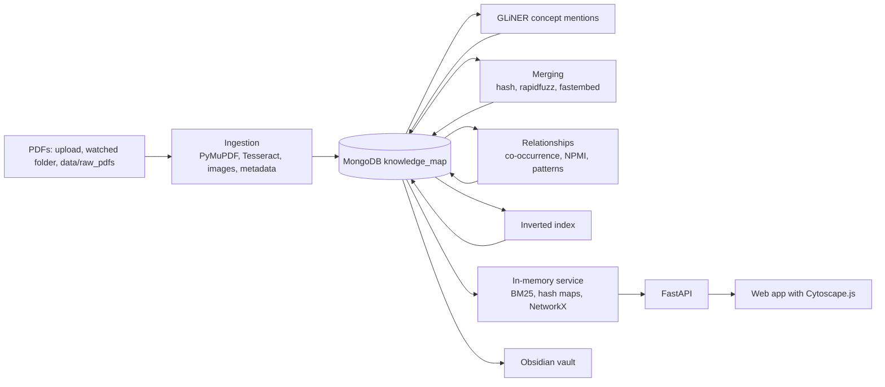

# Knowledge Map: project report

## Abstract

Knowledge Map is a local prototype that turns PDF books into a source-backed knowledge map. It extracts page text and images, finds concepts with a small local NER model (GLiNER), merges names with the same meaning into one concept node, links concepts that occur together, and answers questions by quoting sentences from the documents. Every answer sentence, concept description and relationship carries a citation of the form `[Document Title | Author/Editor | Year, p. N]`, and every returned quote is checked against the stored page text. When the evidence is weak, the system answers exactly "Not found in the uploaded documents." It runs on one laptop with MongoDB, Python and a browser, calls no external LLM, and keeps itself up to date when documents are added, changed or deleted. On two systems engineering books (590 pages), the full pipeline from scratch took 34 minutes in a measured run while other work shared the CPU. About 18 minutes is projected for a machine with no other load. A question is answered in about 22 ms (median), and all 567 quotes returned in the measurement were verbatim slices of the cited pages.

## 1. Problem statement

Technical knowledge is locked in long PDFs. Readers need to see which ideas a book covers, how they connect, and where exactly something is said. Generative chat tools answer fluently but can state things that are not in the source and often cite loosely. This project needs the opposite trade-off: answers that are less fluent but always traceable to a page, and a refusal when the documents do not say it.

## 2. Objectives

1. Extract text (with OCR fallback) and images from PDFs, keeping page provenance.
2. Find concepts, and merge different names for the same concept into one node.
3. Connect concepts with context-based relationships that carry evidence.
4. Store everything with sources, idempotently, so repeated runs create no duplicates.
5. Provide fast keyword search and extractive question answering with compulsory citations and no hallucination.
6. Show the map, search and answers in a simple web app, and export an Obsidian vault.
7. Keep the collection current: added, changed and deleted documents flow through the whole pipeline, also from a watched folder.
8. Stay lightweight: no Neo4j, no vector database, no Node build step, no Docker.

## 3. System architecture

MongoDB is the single source of truth. Everything the server needs at query time (postings, alias hash map, page texts, the graph) is loaded into memory at start and reloaded after each document change. `docs/DATA_FLOW.md` describes each step and collection in detail.

## 4. Technology choices

| Choice | Reason |
|---|---|
| MongoDB (already in use) | Documents, pages, mentions, concepts, edges and the index are all JSON-like records with nested evidence lists. One local server stores them all with upserts by stable ID. |
| NetworkX instead of Neo4j | The graph has about a thousand nodes and a few thousand edges. Built from MongoDB, it fits easily in memory, and degree, PageRank and Louvain communities are computed in seconds. Neo4j would add a second database to install, secure and keep in sync, with no benefit at this size. MongoDB keeps the evidence; NetworkX is a disposable in-memory view. |
| Own BM25 over a MongoDB inverted index instead of a vector database | Questions about technical books are dominated by exact terms ("work breakdown structure"). BM25 with stemming finds them, explains why a page matched, and needs no extra service. Query time is a few dictionary lookups. |
| GLiNER medium (local, CPU) | Zero-shot entity spans with custom labels, no training and no API. It only points at text that exists, which fits the no-hallucination rule. |
| fastembed bge-small (ONNX) only for merging | Name embeddings catch variants that string rules miss. ONNX runtime is small, and the model is used offline during merging only, never at query time. |
| FastAPI + vanilla JS + vendored Cytoscape.js | One Python process serves the API and the page. No Node.js, no build step, and it works offline. |
| Polling folder watcher | Works the same on Windows, Linux and macOS and needs no extra dependency. A 5-second interval is enough for documents. |
| Project `.venv` with pinned `requirements.txt` | Isolates the project's torch, Pillow and numpy versions from other projects on the same machine. `python -m src.envcheck` reports any mismatch. |

## 5. Methodology

### 5.1 Ingestion

PyMuPDF reads each page's text layer (`sort=True`). Pages with little text but raster content go through Tesseract. Each page becomes a `content_units` record keyed by `stable_id("content_unit", document_hash, "page", n)`. The document key is the SHA-256 of the PDF, so the same file is never processed twice. Images of at least 100 x 100 pixels covering at least 1 percent of the page, and not repeated on more than 3 pages, are saved with page, bounding box, a nearby "Figure/Table N" caption and the surrounding text. Optional ViT-GPT2 captions are off by default and never used as evidence.

### 5.2 Citation metadata

Title, author/editor and year are read only from text that is present: PDF metadata (junk values such as "Intro" or a user name are rejected), the largest-font text on page 1 (only when it is clearly larger than the body text), "Edited by" and "Prepared by" lines, and copyright or date lines in the first 8 pages. Each value records where it was found. Missing values are stored as null and shown as "Unknown". Results for the two books:

| File | Title | Author/Editor | Year | Found in |
|---|---|---|---|---|
| book1.pdf | Systems Engineering - Practice and Theory | Boris Cogan | 2012 | title line p. 4, "Edited by" line p. 1, copyright line p. 4 |
| book2.pdf | Systems Engineering Fundamentals | Defense Acquisition University Press | 2001 | largest text p. 1, "Prepared by" line p. 1, date line p. 1 |

### 5.3 Concept extraction

Pages are split into 200-word chunks. Chunks from 24 pages are sorted by length and run through GLiNER in batches of 8 (`inference(..., batch_size=8)`). Table-of-contents pages and pages with fewer than 15 words are skipped, and dot leaders are blanked without changing character offsets. Names are cleaned (determiners removed, last word singular) and filtered: generic stoplist, fragments starting or ending with function words, mostly non-letter strings, more than 6 words. A page is skipped on later runs when the SHA-256 of its text and the extractor version are unchanged, and results are saved after every page, so runs are resumable.

### 5.4 Merging

Names mentioned at least twice are clustered with union-find in three passes: identical hash key (case, plural, hyphen, spacing), rapidfuzz ratio >= 94, and fastembed cosine >= 0.92. Fuzzy and embedding merges are blocked for incompatible types, different numbers, negation, sub-phrases ("design review" vs "preliminary design review"), and (embeddings) when the differing words are not variants of each other. A merge into an existing cluster must also pass against the cluster's canonical name. All decisions are written to `output/reports/merge_report.csv`.

### 5.5 Relationships

For each concept pair we count shared sentences and shared page windows (a page and the next page of the same document) and compute NPMI over windows. An edge is kept with at least 2 shared sentences, or 1 shared sentence and NPMI >= 0, or at least 3 shared windows and NPMI >= 0.35. The default type is `related_to`. It becomes `is_a`, `part_of`, `used_for` or `causes` only when a fixed phrase pattern sits between the two names in an evidence sentence. Each edge stores up to 8 evidence entries with verbatim quotes and offsets.

### 5.6 Graph

NetworkX builds an undirected graph from MongoDB. Degree, weighted PageRank (power iteration with NumPy) and Louvain communities (`seed=42`) drive node size and color in the app.

### 5.7 Document lifecycle

Upload, "Replace file", "Delete" and the watched folder `data/inbox/` all end in the same knowledge stages. Delete removes every record that carries the document ID and its image and upload folders, and writes a tombstone so the file is not re-added automatically. Merging, relationships and the index are then rebuilt, so nothing derived only from the deleted document survives. Replace adds the new version, copies user-edited metadata, and deletes the old one. The watcher only processes a file after it stayed unchanged for one scan.

## 6. Hashing and keyword search design

| Lookup | Structure | Cost |
|---|---|---|
| Term to pages | `search_index` postings, loaded into a dict at start | O(1) per term |
| Concept by any alias | `concept_aliases`: key = `concept_key(name)` (lowercase, singular, no spaces or hyphens) | O(1) per n-gram |
| Page by document and page number | dict keyed by `(document_id, page_number)`; IDs are `stable_id` hashes | O(1) |
| Concept ID | `stable_id("concept", normalized name)` (SHA-256) | computed, stable across runs |
| Autocomplete | sorted list of names and aliases, binary search on the prefix | O(log n) |
| Unchanged content | SHA-256 of each PDF, of each page text (`extraction_state`, `page_terms`) and of each watched file | skip without reprocessing |

Query flow: tokenize (lowercase, stopwords removed, Snowball stem), BM25 (k1 = 1.5, b = 0.75), +2.0 per query concept mentioned on the page, and an exact-phrase bonus for pages and sentences that contain the query words in order.

## 7. No-hallucination and citation design

1. **Extractive only**: an answer sentence is always `page_text[start:end]`. No text is generated and no LLM is called.
2. **Validator**: before returning, each quote must equal the stored page slice, be a substring of the page, and belong to the cited document and page. Failing quotes are dropped.
3. **Abstention**: a sentence must contain at least 60 percent of the query's IDF weight and score at least 1.0. Words absent from the corpus get the highest IDF, so off-topic questions cannot pass. Otherwise the answer is exactly "Not found in the uploaded documents." with no citations.
4. **Citations at request time** from `data/document_metadata.json`, so edits apply everywhere at once. Unknown fields show "Unknown"; nothing is guessed.
5. **Evidence everywhere**: concept descriptions and every relationship carry verbatim quotes with document, page and offsets.

## 8. Results

All numbers below were measured on the development machine (Windows 11, 8 logical CPU cores, CPU only, Python 3.12.2 in `.venv`, local MongoDB 8.2.6) on 2026-10-22 to 2026-10-25. The scripts used are described with each table.

### 8.1 Corpus and stored data

Counts were read from MongoDB after the final rebuild (`python -m src.pipeline stats` and `collStats`).

| Item | Value |
|---|---|
| Documents | 2 (book1.pdf 368 pages, book2.pdf 222 pages) |
| Pages | 590 (583 with a text layer read by PyMuPDF; 7 with no text detected) |
| Images kept | 161 (all in book1; book2 has 16 embedded images, none passing the size filters) |
| Pages sent to GLiNER | 551 (31 near-empty and 1 table-of-contents page skipped) |
| Concept mention records (name, page) | 4,912 |
| Distinct names before cleaning by mention count | 3,059 |
| Names with at least 2 mentions | 982 |
| Concept nodes after merging | 959 (799 found in one book, 160 in both) |
| Merges | 23 (12 alias hash, 11 embedding, 0 fuzzy) |
| Rejected merge candidates (logged) | 69 |
| Relationships | 2,268 (2,264 related_to, 2 part_of, 1 is_a, 1 used_for) |
| Louvain communities | 210 (171 of them are single concepts with no edge) |
| Inverted index | 7,568 terms, 71,173 postings; `search_index` 7.5 MB of data (3.7 MB on disk) |

The first merge run, before the word-variant guard was added, produced 18 embedding merges. Seven of them joined different things ("wireless network node" with "wireless terminal node", "functions/devices matrix" with "functions/equipments matrix"). The guard removed those seven. All 11 remaining embedding merges are spelling or form variants ("electric system" / "electrical system", "U.S. Department of Defense" / "United States Department of Defense").

### 8.2 Processing time

From scratch, measured by a script that extracts both books into a temporary folder and a throwaway database, runs every stage, and drops the database afterwards. The real `data/` folder and database were not touched.

| Stage | Seconds |
|---|---|
| Text extraction, PyMuPDF (both books, 590 pages; no page needed OCR) | 56.6 |
| MongoDB ingestion of pages and source-page assets | 4.3 |
| Metadata detection and image extraction (161 images kept, 2,318 too small) | 14.2 |
| Loading the GLiNER model | 48.5 |
| Concept extraction (551 pages processed, 1 table of contents and 31 near-empty pages skipped) | 1,902.7 |
| Merging (including the embedding model) | 14.4 |
| Relationships | 4.3 |
| Keyword index | 4.8 |
| **Total** | **2,050.8 (34.2 minutes)** |
| Concept extraction again with no changes (every page skipped by hash) | 0.1 |

This run was on 2026-10-25 while tests, a merge rebuild and server restarts ran on the same machine, so the concept extraction figure is high. (Its merge used the earlier rules; the merge results in 8.1 come from the final code.)

Concept extraction speed: the step 2 version (one GLiNER call per page, unbatched) took about 12 seconds per page in a 5-page trial, which projected to about 2 hours for 590 pages. The batched version measured:

| Run | Pages processed | Seconds | Seconds per page |
|---|---|---|---|
| 96 consecutive pages, nothing else running (2026-10-25) | 91 | 155.0 | 1.7 |
| Full first run on the real database, tests running in parallel (2026-10-22) | 551 | 785.4 | 1.4 |
| Full from-scratch benchmark above, other heavy work in parallel (2026-10-25) | 551 | 1,902.7 | 3.5 |

At 1.7 s per page, the 551 pages take about 16 minutes. That is 7 to 8 times faster per page than the unbatched version, and well under the previous 2-hour estimate. With the other stages (about 140 s in the run above, model load included), a full run from scratch is projected at about 18 minutes without other load.

Re-running `python -m src.pipeline run` on unchanged books took 16.0 s in total. Every page was skipped by hash, so only merging (9.2 s), image links (3.7 s), relationships (2.0 s) and the index (0.7 s) ran.

### 8.3 Document changes through the running server

Measured with a script that wrote a generated 2-page PDF into `data/inbox/`, replaced it with a 3-page version, then deleted it, polling the API on a server started with `uvicorn src.api.app:app` (watch interval 5 s).

| Change | Time until processed | Result |
|---|---|---|
| Add (first job after server start, includes loading GLiNER and the embedding model) | 136.2 s | 2 pages, 7 concepts, source `watch:watch_test_mbse.pdf` |
| Edit (file overwritten with a new version) | 31.2 s | one document with 3 pages; old version deleted |
| Delete (file removed) | 31.0 s | documents, pages, images, concepts, relationships and index terms back to exactly the values before the test; questions about its content return "Not found in the uploaded documents." |

The same checks through the app's own endpoints (what the Documents screen calls), with a generated 2-page PDF, on 2026-10-25:

| Action | Time | Result |
|---|---|---|
| Upload (first job after server start, models loaded) | 69.3 s | 2 pages; title "Unknown" because the page uses one font size |
| Edit metadata (title, author, year) | immediate | the next answer cited `[Digital Twin Notes \| Test Author \| 2026, p. 2]` |
| Replace file with a 3-page version | 17.6 s | one document, 3 pages, edited metadata kept |
| Delete | 8.1 s | all counts back to the values before the test |

### 8.4 Search and answer latency

Measured by calling the service directly on the real database: 15 questions (10 about the books, 5 off-topic), each asked 3 times after one warm-up, 45 calls each for `/ask` and `/search` logic. Final code, with the exact-phrase bonus and page tokens computed at load (loading all caches took 1.6 s):

| Operation | Median | Mean | p95 | Max |
|---|---|---|---|---|
| ask | 21.0 ms | 24.0 ms | 48.5 ms | 52.3 ms |
| search | 20.1 ms | 22.8 ms | 42.8 ms | 44.1 ms |

An earlier measurement without the phrase bonus gave a median of 22.2 ms for ask and 20.4 ms for search, with a 0.47 s cache load. Over HTTP on the running server, single questions took 10 to 16 ms on the server side.

### 8.5 Answer checks

In the same run, all 567 returned quotes (answers and search snippets) equalled the stored page slice for their cited document and page. All 10 on-topic questions returned cited sentences, and all 5 off-topic questions ("What is the capital of France?", "Who won the 2018 FIFA World Cup?", "How do I bake sourdough bread?", "What is the boiling point of mercury?", "quantum chromodynamics lattice gauge theory") returned "Not found in the uploaded documents." This shows the answers are grounded. It does not measure how relevant they are: some returned sentences are only loosely related to the question (see Limitations).

### 8.6 Tests

`python -m pytest`: 61 passed (2026-10-25, 6.9 s). The suite uses mongomock and mocked GLiNER and embedding models. It covers idempotent ingestion and extraction, noise filtering, merging (including cases that must not merge), relationship evidence, the inverted index and BM25, hash lookups, citation format, the citation validator, abstention, verbatim quotes across sample questions, metadata detection and editing, image extraction, add/replace/delete, the watched folder, the environment check, and API smoke tests.

## 9. Limitations

- **Relevance**: sentences are chosen by keyword coverage, not understanding. Answers can be loosely related, partial, or combine sentences from different contexts. Each one is cited, so the reader can check it.
- **Two-column pages**: the original extraction (PyMuPDF `sort=True`) sometimes interleaves columns, which shows up in quotes from book2. Changing extraction was out of scope.
- **Concept quality**: GLiNER types come from a fixed label list and are sometimes wrong. Some names are still generic ("study", "knowledge") or partial.
- **Relation types**: 2,264 of 2,268 edges are `related_to`. The phrase patterns are precise but rarely match.
- **Citation pages** are PDF page numbers, not printed page numbers.
- **Metadata** detection only reads PDF metadata and the first 8 pages; a single-font title page yields "Unknown".
- **Full rebuild per change**: merging, relationships and the index are rebuilt for the whole collection after each change, about 30 s for two books. This grows with the collection.
- **CPU only**: GLiNER dominates processing time.
- **Single user and single job**: no authentication, one job at a time, job progress lost on restart.

## 10. Future work

- **MCP server and API keys**: expose `/search`, `/ask`, concept detail and graph queries as MCP tools, and add API-key authentication, so any GenAI client can fetch cited context.
- **Optional LLM answer mode**: let an LLM write a fluent answer only from the retrieved, validated quotes, show the quotes next to it, and keep the extractive answer as the default.
- **Neo4j if needed**: if the graph grows to millions of edges or needs multi-hop queries, the `relationships` collection can be loaded into Neo4j without changing the source of truth.
- **Better layout extraction** for multi-column pages, and printed page labels in citations.
- **Incremental merging and relationships**, so a change only touches affected concepts.
- **Better relation typing**, for example a small supervised classifier trained on the pattern matches.
